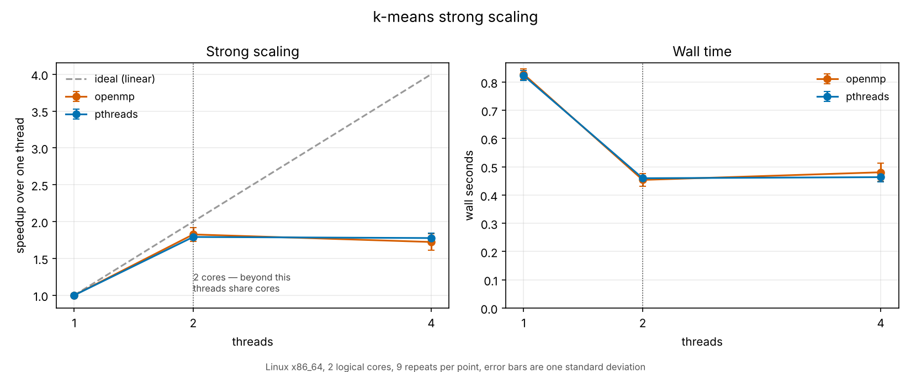
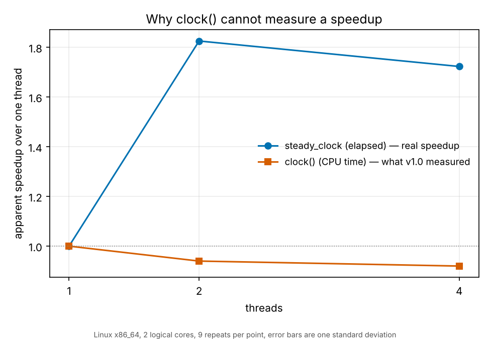

# Parallel k-means++

k-means++ in C++17 with four execution backends — serial, pthreads, OpenMP
and MPI — a benchmark harness that measures scaling properly, and a test
suite that holds the parallel versions to producing *bitwise identical*
results to the serial one.

This is version 2. Version 1 is preserved in [`legacy/`](legacy/), and
[`BUGS.md`](BUGS.md) is the audit that prompted the rewrite: its headline
finding is that v1.0's recorded 5.2× speedup was measured against a baseline
compiled without optimisation, so a single compiler flag was worth more than
the parallelisation it was demonstrating.

```bash
cmake -S . -B build -DCMAKE_BUILD_TYPE=Release -DKMEANS_NATIVE_ARCH=ON
cmake --build build --parallel
ctest --test-dir build --output-on-failure

./build/kmeans --n 2000000 --k 20 --backend pthreads --threads 4 --silhouette 5000
mpiexec -n 4 ./build/kmeans_mpi --n 2000000 --k 20
./scripts/run_experiments.sh          # build, test, measure, plot
```

---

## What this is worth, measured

All numbers from a 2-core Intel Xeon (AVX-512), n = 500,000, k = 20, 100
iterations — the configuration v1.0's headline number was recorded at.
Regenerate them with `scripts/reproduce_audit.sh` and `scripts/run_experiments.sh`.

| | Wall time | Factor |
|---|---:|---:|
| v1.0 as built (`-O0`) | 69.69 s | — |
| v1.0 at `-O2` | 5.07 s | 13.8× |
| this version, serial, `-O2` | 1.55 s | 3.3× |
| this version, 2 threads, `-O2` | 0.79 s | 2.0× |
| this version, 2 threads, `-O3 -march=native` | 0.56 s | 1.4× |
| | | **124× overall** |

The order matters more than the total. Parallelism is the *smallest* of the
four factors. Compiling the serial code properly was worth 13.8×; fixing the
data layout and the loop structure was worth another 3.3×; threads on two
cores were worth 2.0×. The first rule of performance work is to optimise the
serial code before parallelising it, and v1.0 is what happens when that rule
is skipped.

### Strong scaling

2,000,000 points, k = 20, 30 iterations, 9 repeats per point.

| Threads | pthreads | efficiency | OpenMP | efficiency |
|---:|---:|---:|---:|---:|
| 1 | 0.823 s | — | 0.828 s | — |
| 2 | 0.460 s (1.79×) | 89.6% | 0.454 s (1.83×) | 91.3% |
| 4 | 0.463 s (1.78×) | 44.4% | 0.481 s (1.72×) | 43.1% |

Two cores, so four threads is oversubscription and buys nothing — shown
rather than omitted, because a scaling table that stops at the flattering
point is not a scaling table. Weak scaling, doubling the points with the
threads, holds **85.6%** efficiency.



### Why v1.0's speedup table could not exist

`clock()` returns CPU time summed over all threads, not elapsed time, so on
*p* busy threads it reports roughly *p* × wall. Running the committed v1.0
parallel program unchanged, its own reported time **rises** from 3.14 s at 2
threads to 3.59 s at 32. It cannot produce a falling curve.



Every binary here prints both clocks and their ratio, so the distinction is
visible on every run:

```
wall:        0.5605 s
cpu:         1.0761 s
cores used:  1.92   <- cpu/wall; this is why clock() cannot measure speedup
```

### Vectorisation

The distance kernel is ~95% of the runtime. Loop inverted so the inner loop
runs over points for a fixed centroid, with a branchless select, which gives
the compiler independent lanes instead of a dependent min-and-argmin chain:

| Build | Wall (1M points, k = 20, 30 iterations) |
|---|---:|
| `-fno-tree-vectorize` | 0.776 s |
| `-march=native` (GCC picks 256-bit) | 0.535 s |
| `-march=native -mprefer-vector-width=512` | **0.392 s** |

GCC defaults to 256-bit vectors even on AVX-512 hardware, because wide
instructions can pull the clock down on some Skylake-SP parts. On this chip
and this kernel they do not: forcing 512-bit is worth 37%. It is a build
option (`-DKMEANS_VECTOR_WIDTH=512`), not a default, because that trade is a
property of the chip as much as the code.

`scripts/check_vectorisation.sh` reads the compiler's own optimisation report
and fails if that loop stops vectorising. It runs in CI, so a change that
quietly defeats the vectoriser breaks the build rather than halving
throughput unnoticed.

### Seeding

k-means++ seeding was O(n·k²) — it recomputed every point's distance to every
chosen centroid each time it added one. Carrying a running nearest-centroid
distance forward gives identical seeds in O(n·k):

| n = 500,000 | k = 20 | k = 100 |
|---|---:|---:|
| v1.0, O(n·k²) | 0.115 s | 3.355 s |
| this version, O(n·k) | 0.032 s | 0.084 s |
| | 3.6× | **39.8×** |

---

## Identical results on every backend

The parallel backends do not merely *approximate* the serial answer; they
reproduce it exactly, at every thread count, on every run.

That is a design decision, not luck. Floating-point addition is not
associative, so a reduction that merges partial sums in completion order
gives a different answer at 2 threads than at 4. Here the points are split
into a fixed number of blocks that does not depend on the thread count,
partial sums are accumulated per block, and the blocks are merged in index
order. The schedule decides *who computes* a block, never *what is added to
what*.

Three things fall out of it:

- **The tests can demand equality rather than a tolerance.** A tolerance wide
  enough for reduction noise is wide enough to hide a real bug.
- **The scaling tables carry an inertia column, and it never moves** — the
  same value appears for every backend and thread count, so a reader can see
  that the faster configurations are doing the same work.
- **The MPI program is bitwise identical to the serial one too.** Each block
  is owned by exactly one rank, so the all-reduce adds one real value and
  *p*−1 exact zeros per cell. `mpiexec -n N ./build/kmeans_mpi --self-check`
  asserts it; CI runs it at 1, 2, 3 and 4 ranks.

The decomposition also removes a bug by construction. v1.0 computed
`chunkSize = n / numThreads` and gave thread *t* the range
`[t·chunk, (t+1)·chunk)`, so the last `n % numThreads` points were never
assigned by anyone. Block bounds here are computed from the index, so they
tile `[0, n)` exactly for any n.

The guarantee is over thread counts, not block counts: a different `--blocks`
is a different summation order and may differ in the last bits. The benchmark
never varies it within a comparison, and a test documents the boundary.

## Layout

```
include/kmeans/   core types, executor interface, kernels, metrics
src/              the algorithm, written once; three dispatch policies
apps/             CLI, and the MPI program
bench/            scaling harness: repeats, mean, stddev, strong and weak
tests/            47 GoogleTest cases plus an MPI self-check
legacy/           v1.0, exactly as committed, so the audit can be rerun
scripts/          pipeline, audit reproduction, vectorisation check, plots
```

Lloyd's algorithm is written once, in terms of "run this function over every
block". `Executor` is the only thing the backends disagree about: serial
loops, OpenMP uses a parallel for, pthreads uses a persistent pool
synchronised with barriers. So the parallel implementation is three small
classes rather than three copies of the algorithm that must be kept in step.

The pool matters on its own. v1.0 created and joined threads *inside* every
iteration — 100 iterations × 2 phases × 32 threads is 6,400 `pthread_create`
calls per run, an overhead that grew with the thread count, which is exactly
the wrong direction for a scaling study.

## Testing

47 GoogleTest cases plus an MPI self-check, in about 2.5 seconds. Clean under
AddressSanitizer, UndefinedBehaviorSanitizer and ThreadSanitizer, and clean
at `-Wall -Wextra -Wpedantic -Wconversion -Wsign-conversion -Wvla -Wshadow
-Werror`.

The tests are aimed at the specific defects in [`BUGS.md`](BUGS.md):

- `partition_test` — block ranges tile `[0, n)` exactly, for every n and
  block count. The dropped-remainder bug.
- `determinism_test` — every backend at every thread count, bitwise.
- `clustering_test` — blobs with known centres are actually recovered;
  inertia never rises; every point ends up labelled; empty clusters are given
  real points; convergence stops the loop early.
- `seeding_test` — seeds are data points, spread across separated blobs,
  reproducible from the seed, and cheaper than uniform seeding on average.
- `metrics_test` — the silhouette regression: a singleton cluster scores 0,
  not 1; a wrong clustering scores low; sampled agrees with exact.
- `executor_test` — every block runs exactly once; blocks genuinely run
  concurrently; the pool survives being reused.

One note on ThreadSanitizer: it runs with OpenMP disabled. GCC's libgomp is
not built with TSan instrumentation, so TSan cannot see the implicit barrier
at the end of an `omp parallel for` and reports every reduction as a race.
Those are false positives. With OpenMP off, the pthread pool — whose barriers
TSan does understand, and which is the code worth checking — reports nothing.

## Backends

| Backend | Where | Notes |
|---|---|---|
| `serial` | everywhere | the reference every other backend is held to |
| `pthreads` | POSIX | persistent pool, barriers, atomic block claiming |
| `openmp` | where found | `schedule(dynamic, 1)` over the same blocks |
| MPI | separate binary | one all-reduce of `blocks × k` cells per iteration |

The pthreads backend is POSIX-only; on Windows the build omits it and OpenMP
covers the same ground. Substituting `std::thread` under the name "pthreads"
would make the backend name untrue, which is worse than the gap. (v1.0 could
not build on Windows at all — it used variable-length arrays, a GCC extension
MSVC rejects.)

## Build options

| Option | Default | |
|---|---|---|
| `CMAKE_BUILD_TYPE` | `RelWithDebInfo` | never unset; `--version` prints the flags used |
| `KMEANS_NATIVE_ARCH` | `OFF` | `-march=native`; faster, not portable |
| `KMEANS_VECTOR_WIDTH` | *(unset)* | e.g. `512`; measure before setting |
| `KMEANS_ENABLE_OPENMP` | `ON` | built if OpenMP is found |
| `KMEANS_ENABLE_MPI` | `ON` | built if MPI is found |
| `KMEANS_WERROR` | `OFF` | on in CI |
| `KMEANS_BUILD_TESTS` | `ON` | |

Python dependencies are for the plots only: `pip install -r requirements.txt`.

## Limitations

Stated here rather than discovered later.

- **Nothing has been run above 2 cores.** Every number in this file comes
  from a 2-core container. The strong-scaling curve is measured to 2 threads
  and then oversubscribed to 4 to show what that looks like. Whether the
  design holds at 32 threads is untested; the reduction's `blocks × k`
  accumulator and the all-reduce message size are the first things to check.
- **MPI distributes the computation, not the input.** Each rank generates the
  whole dataset and keeps only its own span. A real deployment would read a
  partitioned file.
- **The MSVC and macOS CI jobs have never run.** They are configured and
  expected to need a round of fixes.
- **Two dimensions only.** The kernels are written for 2-D points, as v1.0
  was. Generalising to d dimensions is the obvious next change and would make
  the memory-bandwidth analysis more interesting.
- **Exact silhouette is O(n²)**, which is what the definition costs. Use
  `--silhouette N` for the sampled estimator above a few thousand points.
- **No GPU implementation.** There is no CUDA here and none is claimed.

## Reproducing the audit

```bash
./scripts/reproduce_audit.sh      # builds legacy/ and re-measures every claim in BUGS.md
```

It compiles the v1.0 sources exactly as committed (printing the diff of the
three integer constants it changes to set the problem size), measures `-O0`
against `-O2`, runs the parallel program so it prints its own `clock()`
numbers, counts the distinct values in its silhouette output, and times both
seeding implementations. CI runs it on every push, so the claims in
`BUGS.md` cannot rot into folklore.
